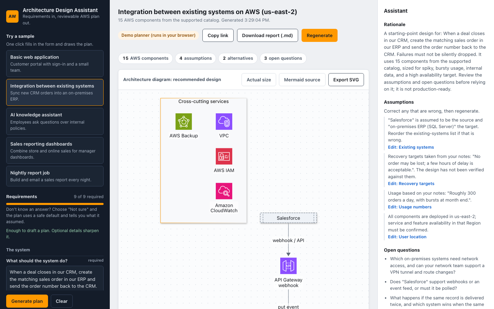
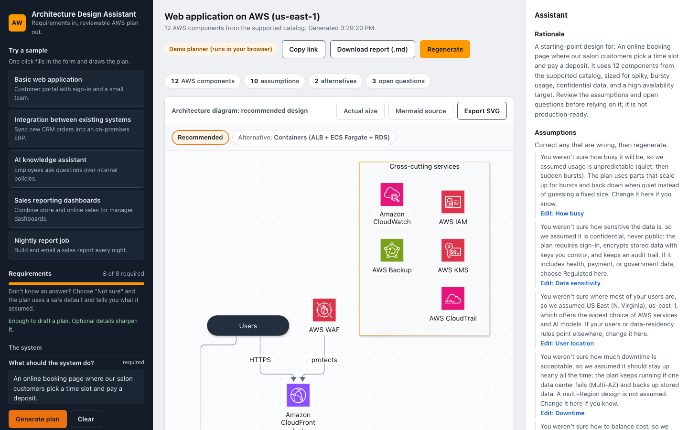
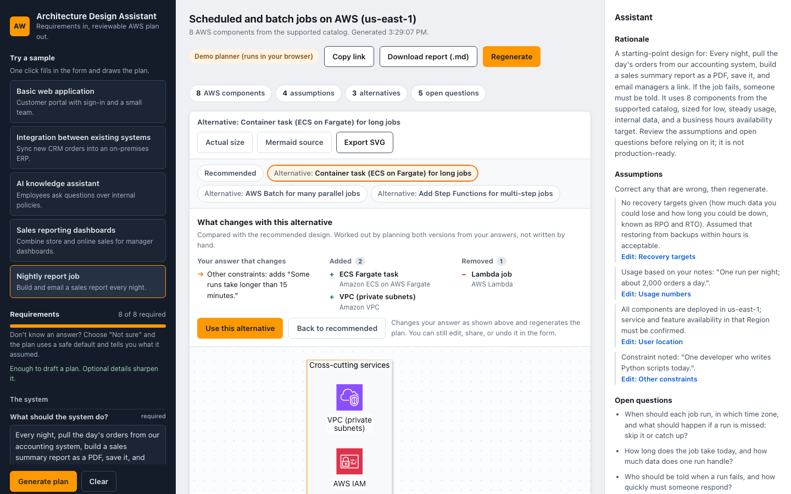

# AWS Architecture Design Assistant (MVP)

[](https://github.com/terrencefreeman27/aws-architecture-assistant/actions/workflows/ci.yml)

A local workbench for people who understand their business problem but not AWS. You describe the system you need, the assistant checks whether it has enough information, asks focused follow-up questions if it does not, and then produces a **reviewable** AWS architecture plan with a diagram.

> This is a planning aid. It never creates AWS resources, never asks for AWS credentials, and its plans are **not production-ready**. Treat every plan as a starting point for review.



## What it does

1. **Requirements discovery in plain language.** The left panel asks questions a non-AWS person can answer ("How busy will it be?", "Where are most of your users?", "How much downtime is acceptable?", "How should cost be balanced against other goals?", "Who will look after it day to day?"), with the precise AWS term as a small hint (AWS Region, availability and recovery, budget, operations). Recovery targets (RPO and RTO) are explained in plain words wherever they appear. A completeness meter shows what is still missing.
2. **"Not sure" is a valid answer.** Usage, data sensitivity, user location, downtime, cost balance, and who runs it accept **Not sure**. It counts as answered; the planner applies a conservative default (below) and the plan lists each one under Assumptions ("You weren't sure about ..., so we assumed ...") with an Edit link. The description and the kind of system have no "Not sure": those must come from you.
3. **Follow-up questions before design.** If a required answer is missing, the assistant returns questions (with the reason each one matters) instead of guessing an architecture.
4. **A structured plan.** Once requirements are complete, the plan includes:
   - an architecture diagram drawn with the official AWS Architecture Icons, exportable as a self-contained SVG
   - the selected AWS components and what each one does in this design
   - a step-by-step data-flow explanation
   - assumptions (each linked to the requirement you can edit to correct it) and open questions
   - security, reliability, performance, operations, and cost considerations
   - at least one alternative with its tradeoffs, and for alternatives the planner can express as a different answer, a diagram of that alternative (see below)
   - a high-level implementation sequence

   A **summary bar** above the diagram counts the components, assumptions, alternatives, open questions, and cautions. Each count jumps to its tab or Assistant section and moves keyboard focus there.
5. **Edit and regenerate.** Change any requirement; the plan is marked stale until you regenerate, and the result visibly changes (for example, switching to "team already uses containers" turns a serverless design into ALB + ECS Fargate + RDS).
6. **Save and share.** Requirements autosave in your browser and come back on reload. **Copy link** puts the requirements into a link; opening it loads them and generates the same plan. If the browser blocks clipboard access, the link appears in a field you can select and copy.
7. **Download report (.md).** A self-contained Markdown design document: requirements as entered, the diagram as a Mermaid block, components, data flow, assumptions, open questions, considerations by pillar, alternatives (each drawn alternative with its own Mermaid diagram and what-changes list), implementation sequence, cautions, the cited AWS documentation, and the share link. See [`docs/example-report.md`](docs/example-report.md).
8. **See an alternative's diagram.** Above the diagram, a switch reads **Recommended | Alternative: ...** for every alternative that can be drawn (the Alternatives tab has a **View its diagram** button for the same). Showing one draws its own diagram with icons, and a **What changes** panel lists the answer that changes, and the components added and removed. **Use this alternative** applies that answer to your requirements and regenerates, so the result is an ordinary plan you can edit, share, and download. **Export SVG** exports whichever design is shown.

Five one-click samples are included: a basic web application, an integration between existing systems (CRM to on-premises ERP), an AI knowledge assistant, sales reporting dashboards (a data pipeline), and a nightly report job (scheduled jobs). Clicking one (in the sidebar, or on the start panel that replaces the empty canvas) fills the form **and** generates the plan immediately.

**On phones** (760 px and narrower) the Generate/Regenerate action is pinned to the bottom of the screen (clear of the home indicator via safe-area insets). After a plan is generated, the form folds into a short "Your requirements" summary with an **Edit requirements** button and the page scrolls to the plan. The diagram starts at actual size with sideways scrolling, because fit-to-width makes the labels unreadable on a phone; **Fit to width** is one tap away.

### "Not sure" defaults

| Question | "Not sure" means | Why this default |
| --- | --- | --- |
| How busy will it be? | Quiet, then sudden bursts (`spiky`) | The design scales up for bursts and back down when quiet, instead of guessing a fixed size. |
| How sensitive is the data? | Confidential (`confidential`) | Never public: sign-in, encryption with your own KMS keys, and a CloudTrail audit trail. Tests assert it is never less protective than public, internal, or confidential. Choose Regulated if it includes health, payment, or government data. |
| Where are most of your users? | US East (N. Virginia), `us-east-1` | The widest choice of AWS services and Amazon Bedrock models. Change it if users or data-residency rules point elsewhere. |
| How much downtime is acceptable? | Almost always up (`high`) | Survives the loss of one data center (Multi-AZ) with backups; a multi-Region design is not assumed. |
| How should cost be balanced? | Keep costs as low as possible (`minimal`) | Favours services that cost little when idle, so an unused system doesn't run up a bill. |
| Who will look after it? | Small team, AWS manages the servers (`small_team`) | Fully managed services with nothing to patch or size. |

"Not sure" is stored as the value `unsure`. The shared pipeline (`shared/unsure.ts`, called from `shared/service.ts`) replaces it with the default before any provider runs, so the demo and live providers both see ordinary answers. Share links, autosave, and the report keep `unsure` as entered (the report says what was assumed). Links and autosaves made before this option existed contain no `unsure` values and still load unchanged.



### Alternatives as real designs

An alternative is drawn only when the planner can express it as a change to your answers: for example "We already use containers (Docker etc.)" for **Who will look after it day to day?**, or a sentence added to **Anything else we should know?** such as "Some runs take longer than 15 minutes." The pipeline applies the change, runs the same deterministic planner, validates the result exactly like the main plan (schema, diagram integrity, catalog, citations), and generates its Mermaid. The **added** and **removed** lists come from comparing the two validated plans, never from hand-written text. Alternatives that cannot be expressed that way (Amplify Hosting, AppFlow, Amazon Q Business, an unbuffered point-to-point integration), or whose variant fails any check, stay text-only and say why. The optional live model provider is never re-run for alternatives; its alternatives are text-only.



## How it stays honest

| Rule | How it is enforced |
| --- | --- |
| The model returns structured data, not diagrams | Providers return JSON validated by a Zod schema (`shared/schema.ts`). Mermaid is generated by the app from validated nodes and connections (`shared/mermaid.ts`), with labels reduced to a safe character set. |
| Only supported AWS components | `shared/catalog.ts` lists 46 supported services. Components outside it are removed from the diagram, reported as validation warnings, and flagged as a caution (`shared/validate.ts`). |
| Invalid diagram data is rejected | Duplicate ids, connections to undeclared nodes, self-loops, unsafe ids, or free-form text instead of structured data produce an error and no diagram. |
| No fabricated citations | `shared/sources.ts` is a typed registry of 56 official AWS documentation pages (AWS Well-Architected Framework, its pillars and lenses, two whitepapers, cost tooling docs, and service overview pages). Each URL was fetched and confirmed (HTTP 200, matching page title) on 2026-10-01. Plans cite registry ids only; unknown ids are stripped, and a claim left with no source is relabelled as an **assumption**. |
| No confident answers it cannot back up | Requests for exact costs, compliance certification, "production-ready" or guaranteed uptime, and other clouds produce explicit cautions instead of answers (`shared/guardrails.ts`). |
| No invented prices | Cost is described as drivers and relative tradeoffs, with links to AWS Pricing Calculator and AWS Budgets documentation for building a real estimate. Tests assert no dollar figures appear. |

## Privacy: autosave and share links

- **Autosave** keeps the requirements form in your browser's `localStorage`, on your device only. **Clear** removes it. If storage is blocked (some private modes), the app still works; it just doesn't remember the form.
- **Share links** carry the requirements in the URL fragment: `#r=` followed by the JSON, compressed with deflate and base64url-encoded. Browsers never send the fragment to a server, so the requirements don't reach Vercel or any other host, only the people you give the link to. Anyone with the link can read what you typed, so don't put secrets in the form.
- Opening a link validates it with the same strict requirements schema the planner uses, with limits on link length and decompressed size. A damaged or edited link shows a message, and the app falls back to your autosaved requirements (or an empty form). A valid link takes priority over the autosave, and the fragment is removed from the address bar once loaded.
- The report is generated and downloaded in the browser. Nothing is uploaded.

## AWS Architecture Icons

The diagram uses the official [AWS Architecture Icons](https://aws.amazon.com/architecture/icons/). The 44 SVGs needed for the 46-service catalog are vendored, unmodified, in [`vendor/aws-architecture-icons/`](vendor/aws-architecture-icons/NOTICE.md) from the Q3 2026 icon package. AWS publishes these terms on that page (checked 2026-10-01):

> "We allow customers and partners to use these toolkits and assets to create architecture diagrams."
>
> "AWS architecture icons are designed to be simple, so you can easily use them in diagrams. You can also put icons in materials like whitepapers, presentations, data sheets, and posters."

The page states no attribution requirement. AWS and the AWS service icons are trademarks of Amazon.com, Inc. or its affiliates, and this project is not affiliated with or endorsed by AWS. The icon files are **not** covered by this repository's MIT license (see [License](#license)); they remain under AWS's terms. See the [NOTICE](vendor/aws-architecture-icons/NOTICE.md) for the package checksum and mapping notes.

How it works: the icons are compiled at build time into a Mermaid icon pack (`web/src/awsIconPack.ts`, using `shared/awsIcons.ts`) that loads together with Mermaid, so there is no runtime fetch. AWS nodes are drawn with Mermaid's flowchart icon shape (`n_fn@{ icon: "aws:lambda", label: "..." }`), still generated only from validated nodes with sanitized labels. Mermaid keeps `securityLevel: 'strict'` and sanitizes icon markup. Icons are inline SVG, so the exported SVG has no external references. People and existing systems keep their plain shapes, and any catalog entry without an icon falls back to a plain box. The **Mermaid source** panel, the API response, and the Markdown report use the icon-free Mermaid, because other Mermaid viewers (GitHub, for example) don't have the AWS icon pack.

## Setup and running

Requirements: Node.js 20.19+ or 22.12+ (developed on Node 25) and npm.

```bash
cd ~/Projects/aws-architecture-assistant
npm install
npm run dev          # API on http://localhost:4080, web on http://localhost:5180
```

Open http://localhost:5180. No credentials or `.env` file are needed; the app starts in **demo mode**.

Run the pieces separately if you prefer:

```bash
npm run dev:api      # Express API (tsx watch) on port 4080
npm run dev:web      # Vite dev server on port 5180, proxies /api to 4080
```

Ports can be changed with `API_PORT` and `WEB_PORT` (both read by the API and by `vite.config.ts`). The web server uses `strictPort`, so it fails instead of silently moving to another port.

To use the planner from Claude Code, Claude Desktop, or the command line instead of the browser, see [MCP](#use-it-from-claude-code--claude-desktop-mcp) and [CLI](#command-line-aws-arch-plan).

Production build of the front end: `npm run build` (output in repo-root `dist/`). The built site runs the demo planner in the browser and needs no API (see [Deployment](#deployment-static-site-demo-planner-in-the-browser)).

### Which planner runs

The UI shows a badge with the planner that produced the plan on screen: **Demo planner (runs in your browser)** or **Server API (provider: demo / anthropic)**.

| `VITE_PLANNER` | Where | Behaviour |
| --- | --- | --- |
| unset (default) | production build (`npm run build`) | In-browser demo planner. No `/api` requests are made. |
| unset (default) | dev server (`npm run dev`) | Probes `/api/health`; uses the API if it answers, otherwise falls back to the in-browser demo planner. |
| `local` | anywhere | Always the in-browser demo planner. |
| `api` | anywhere | Always the server API. If it cannot be reached, the UI says so and offers a one-click switch to the in-browser demo planner; it never swaps silently. |

The in-browser planner runs exactly the same code path as `POST /api/plan` (`planFromInput` in `shared/service.ts`: schema check, completeness gate, guardrails, `DemoProvider`, validation, Mermaid). Tests assert both paths return identical results for the five samples.

To use `npm run preview` against the API, build with `VITE_PLANNER=api npm run build`.

## Deployment (static site, demo planner in the browser)

The public demo is a static Vite build hosted on Vercel; pushes to `main` auto-deploy. There is no server on Vercel: no `api/` directory and no serverless functions. All planning in the deployed site happens in the browser with the deterministic demo planner, the bundled catalog, the sources registry, and the sample scenarios.

Vercel settings (the auto-detected **Vite** preset works as-is, so there is no `vercel.json`):

- Build command: `npm run build` (runs `vite build`)
- Output directory: `dist` (Vite's root is `web/`, but `outDir: '../dist'` writes to the repo-root `dist/`, which is the preset's default)
- Install command: `npm install`
- No environment variables. Leave `VITE_PLANNER` unset (or set it to `local`). Never set `VITE_PLANNER=api` there, and never add `ANTHROPIC_API_KEY`: the static site has no server to use it.
- No SPA rewrites are needed: the app is a single page with no client-side routes.

The optional live Anthropic provider is **server-only** and is available only when you run the API locally (`npm run dev` with `MODEL_PROVIDER=anthropic` and `ANTHROPIC_API_KEY` in `.env`). The client bundle never includes the Anthropic SDK or reads that key; `tests/bundle.test.ts` builds the bundle and fails if it does.

To check a production build the way Vercel serves it (no `/api`):

```bash
npm run build
cd dist && python3 -m http.server 4321      # any plain static server works
# in another terminal:
E2E_URL=http://localhost:4321/ E2E_EXPECT_PLANNER=local npm run e2e
```

## Use it from Claude Code / Claude Desktop (MCP)

The same planner is available as a local [Model Context Protocol](https://modelcontextprotocol.io) server, so an assistant such as Claude can gather your requirements in conversation and call the planner for you. It runs on your machine over stdio and uses exactly the website's pipeline (same schema check, completeness questions, guardrails, "Not sure" defaults, validation, Mermaid, report, and citations from the curated registry only). It uses the deterministic demo planner only: no network access, no model calls, no AWS credentials, no environment variables.

Setup from a fresh clone (no build step; `bin/aws-arch-mcp.mjs` loads the TypeScript sources through `tsx`, which is a regular dependency):

```bash
git clone https://github.com/terrencefreeman27/aws-architecture-assistant.git
cd aws-architecture-assistant
npm install
npm run mcp          # optional smoke test: prints a "running on stdio" line to stderr; Ctrl+C to stop
```

**Claude Code.** Replace `/ABSOLUTE/PATH/TO` with the folder you cloned into (`pwd` prints it):

```bash
claude mcp add aws-architecture-assistant -- node /ABSOLUTE/PATH/TO/aws-architecture-assistant/bin/aws-arch-mcp.mjs
```

Add `--scope user` to make it available in every project. `claude mcp list` should show it as connected.

**Claude Desktop.** Add this to `claude_desktop_config.json` (macOS: `~/Library/Application Support/Claude/claude_desktop_config.json`; Windows: `%APPDATA%\Claude\claude_desktop_config.json`), then restart Claude Desktop:

```json
{
  "mcpServers": {
    "aws-architecture-assistant": {
      "command": "node",
      "args": ["/ABSOLUTE/PATH/TO/aws-architecture-assistant/bin/aws-arch-mcp.mjs"]
    }
  }
}
```

If Claude Desktop cannot find `node` (common with nvm or other version managers), use the absolute path from `which node` as `"command"`.

Tools (all read-only and deterministic):

| Tool | Input | Returns |
| --- | --- | --- |
| `get_requirements_schema` | none | Every requirement field: the plain-language question, why it matters, whether it is required, allowed values with labels, text length limits, and for fields that accept `"unsure"`, the default that will be assumed. The notes and every tool's `requirements` description state the limits up front: description 20 to 2000 characters, existing systems 1000, the three notes fields 500 each, and existing-system names become diagram labels of at most 60 characters (longer names are shortened, not rejected). |
| `get_missing_questions` | `requirements` | `complete`, or `needs_more_information` with follow-up questions (field, question, why) and a completeness score. |
| `plan_architecture` | `requirements` | The validated plan (components, connections, data flow, assumptions, open questions, considerations with source ids, alternatives, steps, cautions), the Mermaid diagram, and validation warnings. Each alternative has a `variant`: `{ kind: "diagram", changes, nodes, connections, mermaid, added, removed }` (applying `changes` to the requirements reproduces it) or `{ kind: "text_only", reason }`. These are additive fields. Incomplete requirements return the questions instead of a plan. |
| `export_report` | `requirements` | The same Markdown design document the website downloads, including a share link that opens the requirements on the public demo. |
| `list_supported_services` | none | The 46-service catalog. |
| `get_sources` | optional `ids` | Entries from the curated source registry; unknown ids are listed separately, never invented. |

The tool descriptions and server instructions tell the calling model to ask you for missing information instead of inventing it, to present plans as not production-ready, never to quote costs, and to cite only sources the tools return. `requirements` uses the field names and values from `get_requirements_schema` (the same JSON as `aws-arch-plan samples <id>` prints). Invalid values come back as a tool error naming the field; unknown keys are ignored and listed in `ignoredFields`.

## Command line (`aws-arch-plan`)

A thin CLI over the same core, for scripts and quick checks. Run it with `npm run cli -- <command>` or `node bin/aws-arch-plan.mjs <command>` (or `npm link` once to put `aws-arch-plan` on your PATH).

```bash
node bin/aws-arch-plan.mjs samples                       # list the five samples
node bin/aws-arch-plan.mjs samples web-app > my.json     # start from a sample, then edit it
node bin/aws-arch-plan.mjs questions my.json             # what is still missing (JSON)
node bin/aws-arch-plan.mjs plan my.json                  # plan + Mermaid + warnings (JSON)
node bin/aws-arch-plan.mjs plan my.json --format md > design.md    # the Markdown design document
node bin/aws-arch-plan.mjs samples integration | node bin/aws-arch-plan.mjs plan - --format mermaid
node bin/aws-arch-plan.mjs catalog                       # supported services
node bin/aws-arch-plan.mjs sources wa-security svc-lambda          # curated sources by id (or all)
node bin/aws-arch-plan.mjs schema                        # fields, allowed values, "unsure" defaults
```

Requirements are read as JSON from a file or from stdin (`-`). Exit codes: `0` success; `1` invalid usage, unreadable file, bad JSON, or values that fail validation (the field and reason are printed to stderr); `2` requirements incomplete, with the follow-up questions printed to stderr and nothing on stdout. Unknown fields are ignored with a warning on stderr.

## Tests

```bash
npm run typecheck    # tsc --noEmit over shared, server, web, and tests
npm test             # vitest: 316 unit, API, client-planner, share, report, icon, bundle, MCP, and CLI tests; no network access, no model calls
npm run e2e          # browser checks + screenshots against a running instance (dev server or static build)
```

`npm test` covers:

- **"Not sure" answers:** each one produces exactly the design of its stated default plus one linked assumption; providers never see `unsure`; data-sensitivity "Not sure" is never less protective than any explicit level; answering "Not sure" everywhere still gives a valid plan; share links made before the option existed still decode; share links, autosave, and the report handle `unsure`. Plain-language labels and RPO/RTO explanations are checked too.
- **Summary bar:** counts come from the plan data, and empty sections are left out instead of linking nowhere.
- **Incomplete requirements:** empty or partial input returns follow-up questions and no plan; integrations require existing systems; an unmatched workload type asks instead of guessing.
- **Unsupported service suggestions:** services outside the catalog are removed, flagged, and never reach the diagram.
- **Invalid diagram data:** dangling connections, duplicate ids, self-loops, unsafe ids, missing sections, and free-form diagram text are rejected (also through the HTTP API, which returns 422).
- **Questions it should not answer confidently:** cost, compliance, production readiness, other clouds, regulated data, and mission-critical availability produce cautions; plans contain no dollar figures and never claim to be production-ready.
- **Citations:** every source id cited by every demo plan, across all 2,880 combinations of the main requirement options (five samples), exists in the curated registry; all registry URLs are official `docs.aws.amazon.com` pages.
- **Diagrams render:** generated Mermaid for every sample parses with Mermaid itself (jsdom), including labels containing hostile text.
- **New patterns (data pipeline, scheduled jobs):** completeness gating, no existing systems required (with an assumption when none are named), valid plans with every section and no warnings, determinism, no cost figures, regulated-data cautions, and each keyword-driven choice (streaming, warehouse, SFTP, Step Functions; long jobs, container teams, parallel jobs, multi-step runs, file queues, sync history, on-premises VPN).
- **Long answers:** for every pattern, maximum-length answers and existing-system names longer than 60 characters still produce a valid plan (labels are shortened, never rejected).
- **Alternative variants:** every alternative of every sample is either drawn (equal to an independent run of the planner with its changes applied, validated with no warnings, Mermaid that parses with and without icons, what-changes lists equal to the computed diff, registry-only citations) or text-only with a reason; drawn variants stay valid across 240 option combinations; "Use this alternative" round-trips and offers the way back; "Not sure" answers survive applying an alternative; providers without alternative specs are not re-run; invalid, incomplete, or no-op changes stay text-only; a provider-supplied variant is stripped; the report embeds each drawn alternative; MCP returns the variants.
- **Determinism and editability:** the same input always produces the same plan, and changing operations, sensitivity, availability, Region, existing systems, or document type changes the plan.
- **Client/server parity:** the in-browser planner returns the same validated plan as `POST /api/plan` for all five samples, and the same questions and schema errors for incomplete or malformed input. Planner mode selection is covered for every `VITE_PLANNER` / dev / production combination.
- **Share links:** round-trip for all five samples, and after "Use this alternative"; empty, garbled, truncated, tampered, oversized, and compression-bomb links are rejected safely, as are schema-invalid payloads (unknown enums, Regions, keys, wrong types, over-long text).
- **Markdown report:** every section is present for every sample; the Mermaid block equals the generated Mermaid; every URL is a registry source (or the share link); no dollar figures; Markdown, HTML, and link syntax in user or provider text is escaped so it can't change the document structure.
- **Icons:** every catalog service maps to a vendored icon file (and nothing extra is vendored); icon bodies contain no scripts, images, or external references; icon-mode Mermaid parses for every sample, falls back to plain shapes where there is no icon, and keeps hostile labels contained.
- **MCP server:** spun up in-process (SDK in-memory transport) and as a stdio child process through `bin/aws-arch-mcp.mjs`. Every tool is called: `plan_architecture` and `export_report` equal the website's plan, Mermaid, and report for all five samples, including the alternatives' variants; incomplete input returns questions and no plan; invalid input, wrong types, and unknown tools return tool errors and the server keeps working; "Not sure" answers become the documented defaults and assumptions; every cited source id exists in the registry; unknown keys are reported; the tool list and input schemas are snapshot-tested, and the descriptions carry the ask-don't-invent, not-production-ready, no-cost-figures, and cite-only-returned-sources rules.
- **CLI:** every subcommand runs as a child process (`bin/aws-arch-plan.mjs`): plans and reports equal the website's for the samples, stdin and file input, all three output formats, exit code 2 with questions on stderr for incomplete input, exit code 1 for invalid values, bad JSON, missing files, unknown formats, commands, and options.
- **Core API:** `shared/core.ts` returns the same plan and the same report (including a share link that decodes back to the requirements) as the website's code path.
- **No secrets in the bundle:** a real `vite build` is checked for the Anthropic SDK, `ANTHROPIC_API_KEY`, the Anthropic API host, and the live provider's prompt.

`npm run e2e` (`scripts/e2e-screenshots.mjs`) drives Chromium through `playwright-core` against a running instance (`E2E_URL`, default the dev server). With `E2E_EXPECT_PLANNER=local` it also asserts the planner badge and that no `/api` request is made. It checks the start panel and that a sample click generates a plan with no extra click; loads each of the five samples and checks the service icons render, including the new services (Quick Sight, EventBridge Scheduler, Athena, Glue, Redshift Serverless, Data Firehose); switches the diagram to an alternative and checks the toolbar label, the what-changes lists, the exported SVG, Back to recommended, View its diagram from the Alternatives tab, Use this alternative (answer written into the form, plan regenerated, way back offered, share link reopens it, report includes the alternatives), and the text-only notes; checks the switch at 1024 and 390 px without overflow; checks every summary-bar jump (mouse and keyboard) and arrow-key tab navigation; answers "Not sure" to every allowed question and checks the six assumptions, their Edit links, the confidential-by-default diagram, the report, and the share link; at 390 px checks the pinned action bar, the collapse-and-scroll after generating, focus on the plan heading, the readable sideways-scrolling diagram, Edit re-opening the form, and that the bar never covers content; edits requirements and regenerates, copies a share link and opens it in a fresh browser context (same plan), reloads to confirm the autosave, downloads the Markdown report and checks its sections, exports the SVG and confirms the icons are embedded inline, checks a tampered link, the clipboard fallback, and blocked `localStorage`, checks the follow-up-question path and guardrails, asserts no request leaves the app's origin, repeats the share-link round trip, autosave reload, report download, and SVG export at 1024 and 390 px, checks for horizontal overflow at 1440, 1024, and 390 px, fails on console errors, and writes screenshots to `docs/screenshots/`. It uses a locally installed Playwright Chromium build (revision 1243, matching `playwright-core@1.63.0`); run `npx playwright@1.63.0 install chromium` if you do not have one.

### Continuous integration

`.github/workflows/ci.yml` runs on every push and pull request to `main`, on Node 22 and 24: `npm ci`, `npm run typecheck`, `npm test` (which includes the client-bundle check), `npm run build`, and `npm audit --omit=dev --audit-level=high`. The Playwright e2e is not run in CI: it needs a specific Chromium build and a running server, and it rewrites the screenshots; run it locally before changing the UI.

## Optional live provider (off by default)

The model provider sits behind a small interface (`shared/provider.ts`). Demo mode uses `DemoProvider`, a deterministic rules-and-templates engine. An optional Anthropic Claude provider exists in `server/providers/anthropic.ts`:

- It runs only on the server. The browser never sees a key, and it is not part of the deployed static site.
- It is used only when **both** `MODEL_PROVIDER=anthropic` and `ANTHROPIC_API_KEY` are set in the API server's environment (or in a local `.env`, which is git-ignored). Otherwise the server logs a note and stays in demo mode.
- It requests structured output matching the same Zod schema, and its output goes through the same validation, catalog check, citation check, and guardrails as demo output.
- It has **not** been exercised against the live API in this MVP, and tests never call it. Using it costs money on your Anthropic account.

```bash
cp .env.example .env    # then set MODEL_PROVIDER=anthropic and ANTHROPIC_API_KEY=...
```

## Supported scope

- AWS only, single-Region designs (Multi-AZ where availability calls for it).
- Five reviewed demo patterns:
  - **Web application**: CloudFront + S3 front end; API Gateway + Lambda + DynamoDB, or ALB + ECS Fargate + RDS/Aurora for container teams.
  - **Integration between existing systems**: webhook or SFTP intake, EventBridge, SQS with a dead-letter queue, Lambda (plus Step Functions for workflows or high availability), Site-to-Site VPN for on-premises targets.
  - **AI knowledge assistant**: Bedrock Knowledge Bases with OpenSearch Serverless, a Bedrock model, Textract for scanned documents.
  - **Data pipeline and analytics** ("Collecting data for reports and dashboards"): sources export into an S3 raw zone, Glue jobs and the Glue Data Catalog write an S3 curated zone, Athena queries it, Quick Sight dashboards, started by EventBridge Scheduler, SNS alerts on failure. Data Firehose when data must arrive continuously, Transfer Family for SFTP drops, Step Functions for high availability or workflows, Redshift Serverless when a data warehouse is asked for. Alternatives: streaming vs batch loads, warehouse vs query in place.
  - **Scheduled and batch jobs** ("Jobs that run on a schedule"): EventBridge Scheduler starts a Lambda job (an ECS Fargate task in a VPC for jobs longer than 15 minutes or teams that use containers, AWS Batch for many parallel jobs), an SQS dead-letter queue, S3 output, SNS notifications, Secrets Manager for existing-system credentials; Step Functions for multi-step runs, an SQS file queue for incoming files, DynamoDB run history for syncs, Site-to-Site VPN for on-premises systems. Alternatives: Fargate vs Lambda, AWS Batch vs one task, with or without Step Functions.
- 46 catalog services across edge, compute, data, integration, AI, security, operations, and networking.
- Requirement options: 14 commercial Regions; usage low, moderate, high, spiky; sensitivity public, internal, confidential, regulated; availability best effort, business hours, high, mission critical; budget minimal, moderate, flexible; operations small team, ops team, containers. Each of these six questions also accepts "Not sure" (see the defaults table above).

## Limitations

- **Not production-ready.** Plans are starting points. Validate them with your team and a Well-Architected review.
- **No cost estimates.** Only cost drivers and relative tradeoffs. Use AWS Pricing Calculator with your own numbers.
- **No compliance determination.** Regulated data and compliance keywords produce cautions, not answers.
- **No disaster-recovery design.** Mission-critical workloads are flagged; multi-Region DR is out of scope.
- **Demo mode is template-based.** It recognises a few keywords in free text (on-premises, SFTP/CSV, schedules, workflows, scanned documents, common SaaS names, real-time or streaming data, data warehouse, long-running or parallel jobs, syncs, incoming files) and otherwise relies on the structured answers. It does not guess the kind of system from the description. Anything outside the five patterns gets a question rather than a design.
- **Region and model availability are not checked.** The plan states the assumption and asks you to confirm service and Amazon Bedrock model availability in your Region.
- **Citations point to overview pages.** Sources support the general practice cited, not every detail of your specific design.
- **Source links can change.** URLs were verified on 2026-10-01 (the five added with the new patterns on 2026-10-21); AWS may move pages later.
- **Not every alternative has a diagram.** Only alternatives the planner can produce from a different answer are drawn; the others are text-only and say why. Some choices are expressed as a sentence added to "Anything else we should know?", which you can edit or remove like any other answer.
- **Diagram layout is automatic.** Large plans can be tall; use "Actual size" and scroll, or export the SVG.
- **No accounts or server-side storage.** Requirements autosave only in your browser. Share links hold the requirements, not the generated plan; opening one regenerates the plan, so a link opened against a newer version of the app may produce a different plan.
- **Some icons are the parent service's icon.** The icon package has no separate icon for ECS on Fargate, Application Load Balancer, Amplify Hosting, Bedrock Knowledge Bases, OpenSearch Serverless, or Q Business, so their parent service's icon is used (listed in the NOTICE). The same applies to Redshift Serverless (Amazon Redshift), Quick Sight (Amazon Quick), and EventBridge Scheduler (Amazon EventBridge).
- **The report's diagram has no icons.** It uses the portable Mermaid so it renders on GitHub and other Mermaid viewers. Use **Export SVG** for the diagram with icons.
- **The deployed site is demo-only.** The public Vercel site runs only the rules-based demo planner in your browser. The live Claude provider needs the local server and your own API key; it is not hosted.
- **The MCP server and CLI are local and demo-only.** They run on your machine over stdio or the command line, use only the rules-based demo planner (never the live Claude provider), and are not hosted anywhere. They need a clone and `npm install`; the package is not published to npm.
- **Large client bundle.** Mermaid ships to the browser; its diagram types are split into chunks that load on demand, so the first visit downloads more JavaScript than the app itself needs. The AWS icon pack (about 46 kB gzipped) loads with Mermaid, not with the initial page.

## Project layout

```
shared/            Logic shared by API, UI, and tests (browser-safe: no Node-only imports)
  schema.ts        Zod schemas for requirements, plans, and API responses
  catalog.ts       Supported AWS component catalog
  sources.ts       Curated, verified official AWS source registry
  requirements.ts  Completeness rules and follow-up questions
  guardrails.ts    Topics answered with cautions instead of confidence
  provider.ts      Provider interface
  demoProvider.ts  Deterministic demo provider (templates + rules)
  validate.ts      Plan validation: schema, diagram integrity, catalog, citations
  mermaid.ts       Mermaid generation from validated data, with label sanitizing
  service.ts       Pipeline: schema check -> completeness -> guardrails -> "Not sure" defaults -> provider -> validation -> Mermaid -> alternative variants
  variants.ts      Alternatives as validated variants: apply changes, re-plan, validate, diff
  scenarios.ts     The five sample scenarios
  share.ts         Share-link encoding and strict, size-limited decoding
  report.ts        Markdown design document from a validated plan, with escaping
  awsIcons.ts      Catalog-to-icon mapping and SVG-to-icon-pack conversion
  options.ts       Labels for form options, Regions, and tiers (used by the UI and the report)
  unsure.ts        "Not sure" defaults, resolution, and the assumptions they add
  core.ts          Small API over the pipeline for the CLI and MCP server (plan, questions, report, catalog, sources, schema, samples)
server/            Express API (port 4080) and optional Anthropic provider
mcp/               MCP server (server.ts: tools; stdio.ts: stdio entry point)
cli/               aws-arch-plan command line (main.ts)
bin/               Node entry points: aws-arch-mcp.mjs and aws-arch-plan.mjs (load the TypeScript through tsx)
web/               React + Vite workbench (port 5180); src/planner.ts picks in-browser vs API planner
tests/             Vitest unit, API, MCP, and CLI tests
.github/workflows/ CI (typecheck, tests, build, audit)
scripts/           Browser e2e + screenshot script
vendor/aws-architecture-icons/  Official AWS Architecture Icons used in diagrams (see NOTICE.md)
docs/screenshots/  Screenshots captured by `npm run e2e`
docs/example-report.md, docs/example-architecture.svg  Sample outputs written by `npm run e2e`
```

## License

The project's own code and documentation are released under the [MIT License](LICENSE), Copyright (c) 2026 Terrence Freemane.

The MIT license does **not** cover the vendored AWS Architecture Icons in [`vendor/aws-architecture-icons/`](vendor/aws-architecture-icons/NOTICE.md). Those files belong to Amazon Web Services and remain under AWS's own terms (quoted in the [NOTICE](vendor/aws-architecture-icons/NOTICE.md)). The same applies to the icon artwork embedded in exported SVG diagrams. AWS and the AWS service names and icons are trademarks of Amazon.com, Inc. or its affiliates.
